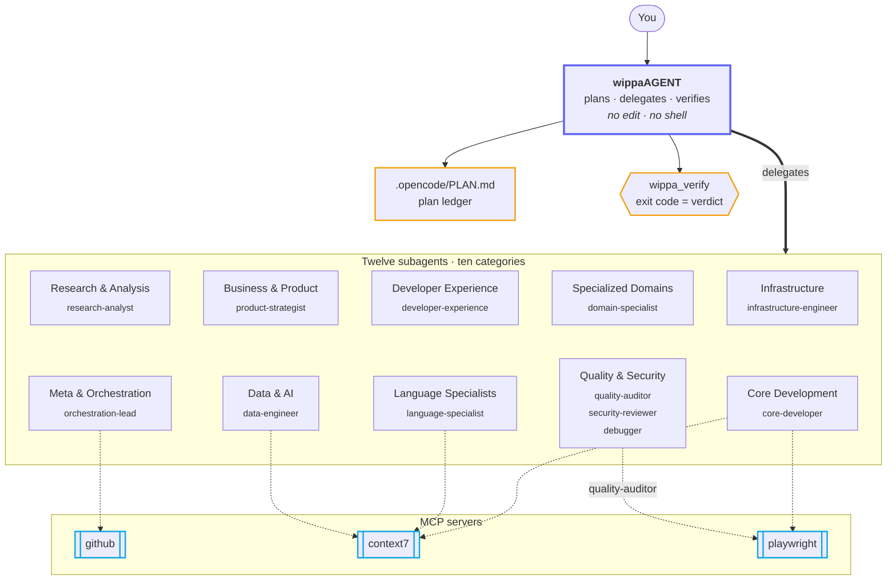
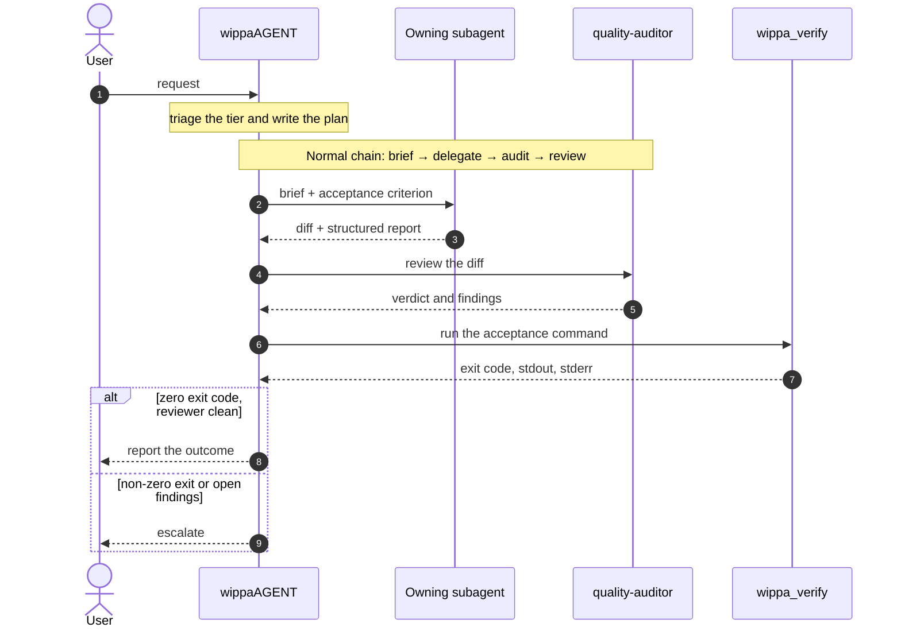
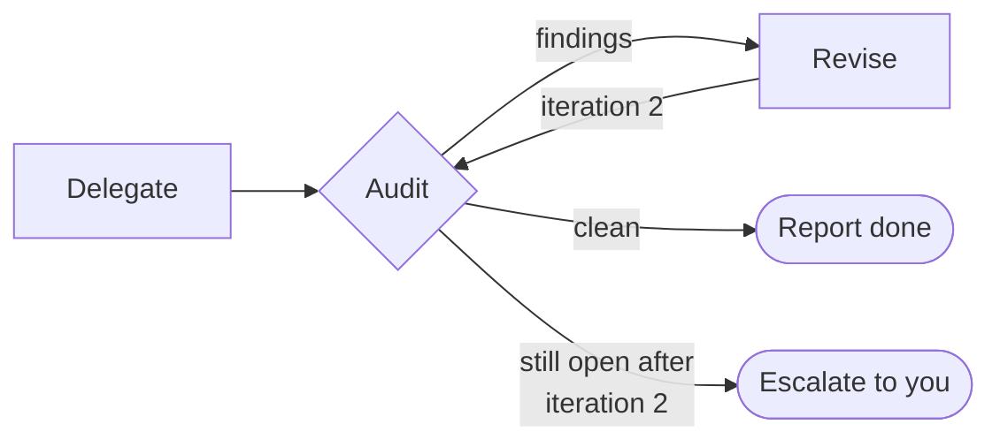

<div align="center">

<!-- wordmark:start - generated from the install.sh banner by npm run wordmark -->
<pre role="img" aria-label="wippaAGENT">
██╗    ██╗██╗██████╗ ██████╗  █████╗        
██║    ██║██║██╔══██╗██╔══██╗██╔══██╗       
██║ █╗ ██║██║██████╔╝██████╔╝███████║       
██║███╗██║██║██╔═══╝ ██╔═══╝ ██╔══██║       
╚███╔███╔╝██║██║     ██║     ██║  ██║       
 ╚══╝╚══╝ ╚═╝╚═╝     ╚═╝     ╚═╝  ╚═╝       
                                            
 █████╗  ██████╗ ███████╗███╗   ██╗████████╗
██╔══██╗██╔════╝ ██╔════╝████╗  ██║╚══██╔══╝
███████║██║  ███╗█████╗  ██╔██╗ ██║   ██║   
██╔══██║██║   ██║██╔══╝  ██║╚██╗██║   ██║   
██║  ██║╚██████╔╝███████╗██║ ╚████║   ██║   
╚═╝  ╚═╝ ╚═════╝ ╚══════╝╚═╝  ╚═══╝   ╚═╝   
</pre>
<!-- wordmark:end -->

### The only OpenCode setup you'll need.

**One orchestrator that can't touch your code. Twelve specialists that can.<br/>
Exit codes, not opinions, decide when the work is done.**

Install once, point the config at the orchestrator, and every project gets the same roster,<br/>
the same routing and the same review discipline.

<br/>

[](LICENSE)
[](https://opencode.ai)
[](https://github.com/wippa-studios/wippaAGENT/actions/workflows/ci.yml)


[](https://github.com/RyanAlberts/best-of-Agent-Harnesses)
[](https://github.com/varun1505/awesome-software-factories)

[**Quick start**](#quick-start) &nbsp;·&nbsp;
[**Why**](#why-wippaagent) &nbsp;·&nbsp;
[**How it works**](#how-it-works) &nbsp;·&nbsp;
[**The roster**](#the-roster) &nbsp;·&nbsp;
[**Trust model**](#trust-model) &nbsp;·&nbsp;
[**Tools**](#tools-and-mcp-servers) &nbsp;·&nbsp;
[**Configuration**](#configuration) &nbsp;·&nbsp;
[**Troubleshooting**](#troubleshooting)

</div>

<br/>

## At a glance

<table>
  <tr>
    <td align="center" width="25%"><h2>1</h2><b>Primary agent</b><br/><sub>Plans, delegates, verifies</sub></td>
    <td align="center" width="25%"><h2>12</h2><b>Subagents</b><br/><sub>Implementation and review</sub></td>
    <td align="center" width="25%"><h2>3</h2><b>MCP servers</b><br/><sub>GitHub, docs, browser</sub></td>
    <td align="center" width="25%"><h2>7</h2><b>Plugin tools</b><br/><sub>Roster lookup, verification and diff reading</sub></td>
  </tr>
</table>

wippaAGENT is a complete OpenCode setup. One primary orchestrator reads the request, plans the work and delegates it. Twelve specialist subagents do the implementation and the review. Three MCP servers give those agents access to GitHub, library documentation and browser automation. A bundled plugin adds roster lookup, an acceptance verifier and diff reading.

<br/>

## Quick start

Three steps and about a minute. You need `bash` and [OpenCode](https://opencode.ai). Node is needed only for step 2's automatic config merge.

**1. Install**

```bash
git clone --depth 1 https://github.com/wippa-studios/wippaAGENT.git \
  && cd wippaAGENT \
  && ./install.sh
```

That is a clone, not a download piped into a shell: you get the whole working tree, and `install.sh` is a plain shell script you can read before it runs.

> [!TIP]
> Want to see exactly what the installer will do? Run `./install.sh --dry-run` first. It prints every planned action and writes nothing.

**2. Point OpenCode at the orchestrator**

```bash
./install.sh --apply-config
```

Or add it by hand to your `opencode.json`:

```json
{
  "default_agent": "wippaAGENT"
}
```

**3. Export a GitHub token, then restart OpenCode**

```bash
export GITHUB_PERSONAL_ACCESS_TOKEN=<your fine-grained token>
```

Use a fine-grained token scoped to one repository with only the Issues, Pull requests, Contents and Actions permissions. The token's scope is the real limit on what the `github` server can reach (see [Trust model](#trust-model)).

**That's it.** Every project you open now has the full roster. To confirm the install, call the `wippa_subagent_list` tool in a session: it returns the twelve subagents, organised by category.

<br/>

## Why wippaAGENT

Most agent loops let one model plan the change, write it, grade it and declare victory. wippaAGENT splits those jobs apart and puts a hard check at the end.

| | A typical single-agent loop | wippaAGENT |
|---|---|---|
| **Who decides it's done?** | The agent that wrote the code | The exit code of your acceptance command, run through `wippa_verify` |
| **Who can edit files?** | Whoever is running | Never the orchestrator. Edit and shell are denied to it by design |
| **Who reviews the diff?** | Often nobody | On Normal and High-risk work, a reviewer sees the diff before anything is reported done |
| **What if review keeps failing?** | Loops until it gives up or burns budget | Stops after two iterations and escalates, with the cost of a fix and a decision for you |
| **What survives the session?** | Whatever the context window held | A plan ledger on disk at `.opencode/PLAN.md` |
| **What does a worker hand back?** | Prose | A fixed schema: files changed, commands with real exit codes, open risks, confidence |

### Design principles

1. **Separation of duties.** The agent that plans does not write, and the agent that reviews does not fix. The reviewers (`quality-auditor`, `security-reviewer`) are denied edit.
2. **Verdicts come from exit codes.** A pass is a zero exit code from a real command, never a model's say-so.
3. **Enforce in permissions, document the rest.** What OpenCode rules can enforce, they enforce. What is only a prompt convention is labelled as one. See the [Trust model](#trust-model).
4. **Auditable routing.** Every request is triaged into a tier, and the tier is written into the plan.
5. **Lean by contract.** The prompt corpus has a token budget enforced in CI, so the setup does not quietly bloat. See [Prompt budget](#prompt-budget).
6. **Additive installs.** The installer never touches files it did not create, and never overwrites without `--force`.

<br/>

## Architecture



*Solid: delegation. Dashed: where the roster routes each server. The dashed lines are routing, not permissions: no rule restricts MCP reach per agent.*

<br/>

## How it works

`wippaAGENT` reads the request and the repository, plans the work, dispatches each piece to the subagent that owns it, reviews what comes back, checks the result against the acceptance criterion and reports the outcome. It holds one line:

> Nothing is reported as done until the acceptance command has returned a zero exit code, and no Normal or High-risk work is reported done before a reviewer has seen the diff.

Four behaviours separate this setup from a plain roster of agents.

### 1. Triage tiers

Every request is classified before a plan is written, and the tier decides the chain.

| Tier | Applies to | Chain |
|------|-----------|-------|
| **Trivial** | Single-file, low-risk work with no behavioural, auth, input, secret, dependency, CI or config impact | Straight to the owning implementer. No audit pass. |
| **Normal** | Everything in between | Brief → delegate → audit → review |
| **High-risk** | Auth, input handling, secrets, dependencies, or anything touching CI or config in a breaking way | Cheap recon pass before anything is written, then a review that cannot be waived |

Tiers escalate, never de-escalate, and the tier chosen is stated in the plan so the routing is auditable. High-risk or structural changes are presented for your approval before any code is written.

*Illustrative examples:*

| Request | Likely tier | Why |
|---------|-------------|-----|
| Fix a typo in a code comment | Trivial | Single file, no behavioural impact |
| Add pagination to a list endpoint | Normal | Behavioural change, no sensitive surface |
| Add a login rate limiter, or bump a dependency | High-risk | Touches auth or the dependency tree |

### 2. One request, end to end



### 3. Two-iteration reviewer cap



The review loop runs at most **two iterations** per piece of work. After the second iteration, if the reviewer still reports open findings, the orchestrator stops looping and escalates to you with three things: what is still broken, what a fix would cost, and whether to accept, defer or fund another round. An open finding at report time is disclosed as an open finding, never hidden behind one more attempt.

### 4. Plan ledger and return contract

**The plan ledger** lives on disk at `.opencode/PLAN.md` in the working directory. It holds the agreed plan, the decisions made (including tier calls and tie-break routings), the work items in flight and completed, and the open risks. Every item names its owner subagent and its acceptance criterion.

The orchestrator denies itself edit, so it delegates the file write with the exact content verbatim. The next session reads the ledger first, and where the ledger and the repository disagree, **the repository is the truth**.

**The return contract.** Every subagent returns the same fixed schema in its final message:

| Field | Contents |
|-------|----------|
| **Files changed** | What was touched |
| **Commands run** | Each command with its real exit code |
| **Open risks** | Anything unresolved |
| **Confidence** | A level, plus a statement of what would falsify it |
| **Acceptance status** | Optional |

The orchestrator reviews those fields rather than the prose around them. A missing field is an incomplete report that goes back to the subagent, never one the orchestrator fills in itself.

<br/>

## The roster

Twelve subagents across ten categories. The **Access** column is what OpenCode permissions allow, so you can see at a glance who can change files and who can only look.

| Agent id | Category | Access | Remit |
|----------|----------|--------|-------|
| `core-developer` | Core Development | edit · shell | Application code end to end: API contract, authentication, services, frontends, GraphQL, mobile, desktop and real-time transport. |
| `language-specialist` | Language Specialists | edit · shell | Language-specific implementation, idiom, tooling and ecosystem conventions across the framework landscape. |
| `infrastructure-engineer` | Infrastructure | edit · shell | Cloud architecture, Terraform, containers, Kubernetes, networking, CI/CD, observability, Windows infrastructure and PowerShell. |
| `quality-auditor` | Quality & Security | shell, **no edit** | The lean general reviewer: correctness, architecture, test strategy, accessibility, interface testing and performance review. |
| `security-reviewer` | Quality & Security | shell, **no edit** | Security audit, penetration testing, Active Directory posture, compliance and privacy, dependency and supply-chain audit. |
| `debugger` | Quality & Security | edit · shell | Bug reproduction and root-cause isolation, error and log analysis, test automation, flake control, resilience and chaos experiments. |
| `data-engineer` | Data & AI | edit · shell | Data platforms, pipelines, databases and query tuning, machine learning and model serving, NLP and reinforcement learning. |
| `developer-experience` | Developer Experience | edit · shell | Build tooling, CLIs, dependency management, documentation and developer ergonomics. |
| `domain-specialist` | Specialized Domains | edit · shell | Regulated and platform-shaped verticals: finance, payments, health, legal, embedded, IoT, blockchain, Microsoft 365, SEO and WordPress. |
| `product-strategist` | Business & Product | edit, **no shell** | Requirements, roadmap, backlog, experiments, content and landing pages, licensing and product decisions. |
| `orchestration-lead` | Meta & Orchestration | edit · shell (asks first on risky commands) | Planning support, multi-domain coordination, agent installation, error recovery and the GitHub issue, pull request, CI and release workflow. |
| `research-analyst` | Research & Analysis | edit, **no shell** | Investigation, comparison, evidence gathering and written analysis, plus cheap recon passes that return a structured summary of files seen, relevant paths and key findings. |

The primary agent, `wippaAGENT`, sits above all of them with **no edit and no shell**. That makes **13 agent files** in total.

<br/>

## Trust model

Permissions are enforced by OpenCode rules, not by prompts. This section is explicit about which guarantees are enforced and which are conventions.

| Guarantee | Mechanism | Strength |
|-----------|-----------|----------|
| The orchestrator cannot edit files or run a shell | `edit` and `shell` denied in its frontmatter | **Enforced** by OpenCode permissions |
| The only command the orchestrator can trigger is the acceptance command | `wippa_verify`, behind its own `verify` permission and a pre-spawn guard | **Enforced**, with a documented residual (below) |
| Reviewers cannot fix their own findings | `edit` denied for `quality-auditor` and `security-reviewer` | **Enforced** |
| Subagents cannot start further subagents | `experimental.subagent_depth` is `1` | **Enforced** (checkout config; installed scopes use OpenCode's documented default, which matches) |
| GitHub reach is narrow | `github` server registered with the `repos`, `issues`, `pull_requests` and `actions` toolsets only, plus the scope of your token | **Enforced** at registration; the token scope is the real limit |
| Routing: which agent owns what | Prompt text | **Convention** |
| The "report only to me" line in every brief | Prompt text | **Convention** |

### How `wippa_verify` is guarded

`wippa_verify` runs the command you give it, so it is behind its own permission action: the tool asserts `verify` with the command as the resource before it spawns anything, and the same rule list that governs `shell` governs it. The shipped frontmatter repeats the shell guards as `verify` rules, so a host with no rules configured is still not left without a guard.

On top of that assertion sits a guard that runs before the permission check and before any spawn. It is an allowlist of the acceptance surface with a character policy on top. **It is not a sandbox.** Its single source is `tools/guards.ts`; every statement below is derived from it. A command that fails the guard never runs, and the reason is returned in the result.

The call runs asynchronously, stops when the call is cancelled, and is bounded by a 5-minute default timeout and capped output. A caller's `cwd` must not contain `..` segments, line breaks or null bytes, or it is refused with a stated reason.

<details>
<summary><b>Character policy</b></summary>

<br/>

- Command substitution, expansion, redirection, pipes, statement separators, newlines and carriage returns are refused anywhere in the command string.
- Only `&&` chains are accepted. Any `&` that is not exactly `&&` (so `&&&` too) is refused.
- A segment beginning `NAME=` is refused as an environment-variable assignment prefix.
- A command word may not be a path. Only the exact string `./install.sh` may be run by path, so a planted `./file` cannot be executed.

</details>

<details>
<summary><b>Allowlist</b></summary>

<br/>

Every segment's command word must be on this list, or be exactly `./install.sh`, or the segment never runs.

| Command | What is allowed |
|---------|-----------------|
| `npm` | Only `test`, `run` and `ls`. The subcommand must come immediately after `npm`, and any option in that position fails closed, so `npm pkg set`, `npm config set` and `npm --yes exec` are refused. |
| `pytest` | Test execution (`pytest`, `pytest tests/`, `pytest -v -k unit`, `pytest --cov=src`). Interactive debugger `--pdb` is refused. |
| `go` | Only `test` and `vet` subcommands (e.g. `go test ./...`, `go vet ./...`). `-exec` and `--exec` are refused. |
| `cargo` | Only `test`, `check` and `clippy` subcommands (e.g. `cargo test`, `cargo check`, `cargo clippy`). |
| `make` | Targets and flags without directory escapes or external file execution (e.g. `make`, `make test`, `make check`). `-C`, `--directory`, `-f`, `--file`, `--makefile` and `--eval` are refused. |
| `node` | Test runner and scripts (e.g. `node --test`, `node tests/runner.js`). Eval flags (`-e`, `--eval`), interactive REPL (`-i`, `--interactive`), and preloads (`-r`, `--require`, `--import`, `--loader`) are refused. |
| `python3` / `python` | Test runners and modules (e.g. `python3 -m unittest`, `python3 -m pytest`, `python3 tests/run.py`). Eval flag (`-c`) and interactive REPL (`-i`) are refused. |
| `git` | Only `status`, `log`, `diff`, `show`, `blame`, `ls-remote`, `rev-parse`, `describe`, `grep`, `shortlog`, `fetch`, plus `branch` and `remote` in pure-listing form. |
| Read-only utilities | `grep`, `rg`, `cat`, `head`, `tail`, `wc`, `ls`, `test`, `echo`, `true`, `false`, `basename`, `dirname`, `realpath`, `pwd`, `sort`, `uniq`, `tr`, `cut`, `stat`, `sha256sum`, `which`, `date`. `sort` and `uniq` only under their read-only flag allowlist; `rg` without `--pre` and `--pre-glob`. |
| Inert utilities | `sleep`, `seq`, `exit` |
| Static checks | `bash -n <file>` (`-n` must be the first argument, every later word a file name) and `shellcheck` |
| Installer | `./install.sh`, only with `--dry-run` |

Everything else is denied because it is not on the list, including `npx`, `sh`, `sed`, `curl`, `gh`, `docker`, `awk`, `xargs`, `find` and `env`.

Nothing is inferred as read-only. `git worktree list`, `git submodule status`, `git stash list` and `git bisect log` are denied: the subcommand allowlist is explicit, so only the subcommands named above pass.

</details>

<details>
<summary><b>Fast-fail denials</b></summary>

<br/>

Each is refused with a reason.

- The `sudo` and `rm` families, network and archive tools, file mutators, `awk` and `xargs` are refused as words, flat and inside quotes.
- Interpreter-plus-eval-flag pairs such as `bash -c`, `python -c`, `node -e` and `sed -i` are refused.
- In a segment whose command word is `git`: global options (`-c`, `-C`, `--git-dir`, `--work-tree`, `--exec-path`, `--paginate`, `--no-pager`) are refused in both `--flag` and `--flag=value` form; any option before the git subcommand fails closed; the exec-channel options `--upload-pack`, `--open-files-in-pager`, `--ext-diff` and `--textconv` are refused anywhere in the segment; and any argument containing `::` (transport syntax such as `ext::cmd`) is refused.
- `git fetch` refuses a `+` refspec.
- `git show`, `git diff`, `git log` and `git archive` refuse `--output`.
- `sort` and `uniq` refuse every option outside their read-only flag allowlist, so `sort -o` writes nothing and `sort --compress-program=…` runs nothing.
- `rg` refuses `--pre` and `--pre-glob`.
- `install.sh` runs only with `--dry-run`, and only as the command itself. `cat install.sh` reads it as data.

</details>

> [!IMPORTANT]
> **Documented residual.** `npm test` and `npm run <script>`, `pytest`, `go test/vet`, `cargo test/check/clippy`, `make`, `node --test`, and `python3 -m unittest` execute whatever the project scripts or tests contain; the guard inspects the command invocation, not the script body. Beyond that, each allowlisted command is policed only where `tools/guards.ts` writes a rule (git's global and exec-channel options, the `sort` and `uniq` flag allowlists, `rg`'s denied `--pre` flags, `bash`'s positional rule, and per-command rules for `go`, `cargo`, `pytest`, `make`, `node` and `python3`), so an option no rule names is passed through to the command itself. An allowed command runs with the authority of the user running OpenCode, and `package.json` scripts are trusted input. Treat an acceptance command as you would any shell command.

### How `wippa_diff` is guarded

`wippa_diff` validates its `base` before it reaches git. Absolute paths, `..` traversal, option-like prefixes and shell-significant characters are refused with a stated error rather than passed through, so the diff tool cannot be used to aim git at an arbitrary path.

### Per-agent enforcement

| Agent | edit | shell | verify | everything else |
|-------|------|-------|--------|-----------------|
| `wippaAGENT` | denied | denied | `rm -rf *`, `sudo *`, `git push --force *` denied | `subagent *` allowed |
| `core-developer`, `language-specialist`, `infrastructure-engineer`, `data-engineer`, `developer-experience`, `domain-specialist` | allowed | allowed | `rm -rf *` and `sudo *` denied | `rm -rf *` and `sudo *` denied |
| `quality-auditor` | denied | allowed | `rm -rf *` and `sudo *` denied | `rm -rf *` and `sudo *` denied |
| `debugger` | allowed | allowed | `rm -rf *` and `sudo *` denied | `rm -rf *` and `sudo *` denied |
| `security-reviewer` | denied | allowed | `rm -rf *`, `sudo *` and `git push --force *` denied | `rm -rf *`, `sudo *` and `git push --force *` denied |
| `orchestration-lead` | allowed | allowed | `rm -rf *`, `git push --force *` and `npm install *` ask; `sudo *` denied | `rm -rf *`, `git push --force *` and `npm install *` ask; `sudo *` denied |
| `research-analyst`, `product-strategist` | allowed | deny all shell | deny all verify | no additional deny rules; read, web and MCP tools remain reachable |

### MCP reach

No rule restricts MCP reach per agent: every agent can reach the `github`, `context7` and `playwright` servers. Two boundaries stand in instead:

1. The `github` server is registered with the `repos`, `issues`, `pull_requests` and `actions` toolsets only. That covers the repositories, issues and pull requests, review comments, CI status and releases the roster routes through `orchestration-lead`, so toolsets this workflow never uses are not even registered.
2. The scope of `GITHUB_PERSONAL_ACCESS_TOKEN` is the real limit on what the `github` server can reach. Use a fine-grained token scoped to one repository, carrying only the Issues, Pull requests, Contents and Actions permissions.

<br/>

## Tools and MCP servers

### The seven plugin tools

The bundled plugin adds seven tools: four for finding and reading the roster, one for checking work, one for reading a diff, and one for updating the session plan ledger.

| Tool | Question it answers |
|------|---------------------|
| `wippa_subagent_search` | Which agents match this task, by name, by category or by a word from their description? |
| `wippa_subagent_get` | What exactly does one agent do? Full definition, prompt and permissions. |
| `wippa_subagent_list` | What is available at all, organised by category? |
| `wippa_subagent_invalid` | Is the cached catalog stale? Clears the cache so the next read is fresh. |
| `wippa_verify` | Did the acceptance command pass? Runs it asynchronously with a timeout, capped output and cancellation, and returns the real exit code with stdout, stderr and how long it ran, so a pass/fail verdict never rests on prose. Runs `npm test/run`, `pytest`, `go test/vet`, `cargo test/check/clippy`, `make`, `node --test`, and `python3 -m unittest`. Commands outside the [guard](#how-wippa_verify-is-guarded) never run. |
| `wippa_diff` | What changed? Returns the working, branch or committed diff as structured per-file entries (patch, additions, deletions, status), so the orchestrator can read the diff itself without a shell. |
| `wippa_plan_update` | How to record decisions and progress without child agent hops? Writes or updates the session plan ledger at `.opencode/PLAN.md` exclusively within the workspace. |

**What the catalog contains.** The catalog is the roster: the twelve agents this bundle ships, plus any id listed in `WIPPA_CUSTOM_AGENT_IDS`. From the global agent directory, where every project's agents live together, only those ids are indexed, so an unrelated agent installed for another project does not appear in a search or inflate a list. A project directory, a `WIPPA_AGENT_DIR` override and the bundle's own tree are indexed in full.

The `wippa-subagent-search` skill documents the four roster tools, explains which one to reach for, and gives the equivalent procedure using `read`, `glob` and `grep` when the plugin is not connected.

### The three MCP servers

| Server | What it gives the agents |
|--------|---------------------------|
| **`github`** | Repositories, pull requests, issues, actions and code security through the GitHub API. Expects `GITHUB_PERSONAL_ACCESS_TOKEN` in the environment. |
| **`context7`** | Version-matched documentation for libraries and frameworks, so guidance matches the version in the lockfile. |
| **`playwright`** | Browser automation: navigate, interact and read the rendered page. Runs locally through `npx`. |

<br/>

## Install reference

The installer writes into one of two scopes.

<table>
<tr>
<td width="50%" valign="top">

**Global**<br/>
Every project on this machine.<br/>
Files land in `~/.config/opencode/`, or in `$OPENCODE_CONFIG_DIR` when that variable is set.

```bash
./install.sh --global
```

</td>
<td width="50%" valign="top">

**Project-local**<br/>
A single project.<br/>
Files land in `<project>/.opencode/`.

```bash
./install.sh --project /path/to/your/project
```

</td>
</tr>
</table>

With no directory argument, `--project` uses the current directory:

```bash
./install.sh --project
```

> [!NOTE]
> The project directory must already exist. The installer creates `.opencode/` inside it, but it does not create the project itself.

### Flags

Every flag is non-interactive, so the installer runs unattended in a script or a CI job.

| Flag | Effect |
|------|--------|
| `--global` | Install into `~/.config/opencode/`, or into `$OPENCODE_CONFIG_DIR` when that variable is set. This is the default. |
| `--project [DIR]` | Install into `<DIR>/.opencode/`. `DIR` defaults to the current directory. The `--project=DIR` form is also accepted. |
| `--dry-run` | Print every planned action and write nothing. |
| `--force` | Overwrite files that already exist. |
| `--uninstall` | Remove the agent files, the skills and the plugin when they still match the installed copy. Files you changed and the config file are left alone. |
| `--apply-config` | Add the required keys the target `opencode.json` is missing and leave the ones you already set alone, except an `agents.build` entry in the demoted shape this installer used to write, which is migrated to `disabled: true` with your other keys kept. JSONC comments and trailing commas are accepted, and the config is validated before anything is copied. |
| `-h`, `--help` | Print the usage text. |

### Requirements

- `bash` and the usual POSIX utilities (`cat`, `cmp`, `cp`, `id`, `ls`, `mkdir`, `printf`, `rm`, `rmdir`)
- `tput` is optional: the installer uses it only to read the terminal width, and falls back to 80 columns when it is unavailable
- Node, **only** when you pass `--apply-config`
- The installer runs from any working directory, and refuses to run if the agent definitions are missing from the checkout it was started from

### What gets installed

| What | From | To |
|------|------|-----|
| Primary agent and twelve subagents | `wippaAGENT.md` and `categories/*/*.md` | `<scope>/agents/` |
| Skills (all of `skills/`, currently seven) | `skills/*/` | `<scope>/skills/*/` |
| Tools plugin | `tools/` | `<scope>/plugins/wippa-subagent/` |

`<scope>` is `~/.config/opencode/` for a global install and `<project>/.opencode/` for a project-local install.

Agent files are copied flat. The category directory is not preserved in the destination, so the agent id is the file name: `categories/01-core-development/core-developer.md` becomes `agents/core-developer.md`. Ids stay flat and predictable. Names in the old single-specialist style, such as `python-pro`, become category-level names here, such as `core-developer`.

> [!IMPORTANT]
> Outside the paths it installs to, the installer never touches files it did not create, and without `--force` it skips anything that already exists rather than overwriting it.

### Updating

Pull the latest checkout and re-run the installer with `--force`. Without `--force` the installer skips files that already exist, so an update would not change them. `--force` overwrites, so move aside any agent file you have edited locally before you run it.

```bash
git pull && ./install.sh --force
```

### Uninstalling

```bash
./install.sh --uninstall
```

This removes the agent files, the skills and the plugin when they still match the installed copy. Files you changed and the config file are left alone, so remove the `default_agent` entry from your `opencode.json` yourself.

<details>
<summary><b>Running OpenCode against this repository</b></summary>

<br/>

The `opencode.json` in this repository configures the checkout itself; it is not the key set the installer writes. `wippaAGENT.md` sits at the repository root, where OpenCode's agent discovery does not look, so a bare `opencode` run in a fresh clone finds no `wippaAGENT` and falls back to the default agent.

To use the repository as a live OpenCode project, install it into the checkout:

```bash
./install.sh --project .
```

That creates `.opencode/` holding the agents, the skills and the tools plugin. With `--apply-config`, it also merges the required configuration keys into `.opencode/opencode.json`. `.opencode/` is gitignored, so a local install never pollutes the repository.

One caveat: a project install flattens the agent files into `.opencode/agents/`, and the plugin's roster lookups prefer that installed copy over the live `categories/` tree. While the install is present, edits to `categories/*.md` do not show up in `wippa_subagent_*` results until you re-run the install with `--force` or remove the installed copy.

</details>

<br/>

## Configuration

The agent set is inert until `default_agent` points at the orchestrator. Add it to the config file for the scope you installed into.

| Scope | Config file |
|-------|-------------|
| Global | `~/.config/opencode/opencode.json`, or `$OPENCODE_CONFIG_DIR/opencode.json` when that variable is set |
| Project-local | `<project>/.opencode/opencode.json` |

```json
{
  "default_agent": "wippaAGENT"
}
```

The installer prints the full set of keys it expects before the summary, whether or not `--apply-config` is passed: `default_agent`, `agents.general`, `agents.explore`, `agents.build` and `mcp.servers`. Run it with `--apply-config` to merge those keys into the target config automatically.

**What `--apply-config` guarantees**

- Every key you already set is left alone and reported as kept.
- The one exception is an `agents.build` entry that still carries the demotion this installer used to write (`mode: "subagent"` plus a deny entry for `subagent` on `*`). It is migrated in place: `mode` and `permissions` are removed, `disabled: true` is set, and every other key you added is kept. An entry of any other shape, including a hand-edited one that also demotes the built-in, is preserved untouched.
- The target may be JSON or JSONC (comments and trailing commas are accepted), and it is validated before the first file is copied, so a config that cannot be parsed leaves nothing half-installed.
- When a key has to be added, the file is rewritten as plain JSON, so comments are not preserved in that case. When every key is already present, the file is left byte-identical.

<details>
<summary><b>What each key does</b></summary>

<br/>

| Key | Purpose |
|-----|---------|
| `default_agent` | Makes `wippaAGENT` the entry point for every session. |
| `agents.general` | Set to `disabled: true`. It is an OpenCode built-in, and this set supplies its own agents in its place. |
| `agents.explore` | Set to `disabled: true`, for the same reason. |
| `agents.build` | Set to `disabled: true`. It is an OpenCode built-in coding agent, and this set supplies its own implementers in its place, so no second implementer appears in the roster. |
| `mcp.servers` | Registers the `github`, `context7` and `playwright` servers. |
| `permissions`, `compaction`, `experimental.subagent_depth` | Checkout-only keys, set in the repository's own `opencode.json`: `permissions` allows `subagent` on `*`, `compaction` summarises long sessions, and `subagent_depth` is `1`, so a subagent cannot start another subagent. `--apply-config` does not merge them, so an installed scope uses OpenCode's documented defaults, which match. |

The skills and the tools plugin need no configuration entry. They are installed into `<scope>/skills/` and `<scope>/plugins/`, and both of those directories are auto-discovery locations in OpenCode V2, so the two are picked up automatically.

</details>

### Environment variables

`env.example` documents the variables the setup expects. Export them in the shell before starting OpenCode.

| Variable | Used by |
|----------|---------|
| `GITHUB_PERSONAL_ACCESS_TOKEN` | The `github` MCP server |
| `WIPPA_AGENT_REGISTRY` | See `env.example` |
| `WIPPA_AGENT_DIR` | The tools plugin. Overrides the agent directory it reads; indexed in full. See `env.example` |
| `WIPPA_CUSTOM_AGENT_IDS` | Comma-separated agent ids expected to live in the user's own global configuration. They are indexed alongside the roster and are exempt from roster drift reporting. Used by the tools plugin. |
| `WIPPA_BANNER` | The installer only. `on` forces the wordmark, `off` suppresses it; unset, it prints only on a UTF-8 terminal wide enough for the art. It has no effect on OpenCode. |

Restart OpenCode after changing the config so the new roster is picked up.

> [!WARNING]
> `opencode debug config` lists every configuration source the session loads. On the CLI versions checked here (v2.2.0 and v2.2.2) MCP server headers are redacted as `***`, but the rest of the resolved configuration prints in full. Treat the output as sensitive, and do not paste it into an issue or a chat.

<br/>

## Troubleshooting

| Symptom | Likely cause | Fix |
|---------|--------------|-----|
| OpenCode starts with its default agent, not `wippaAGENT` | `default_agent` is not set, or OpenCode was not restarted | Run `./install.sh --apply-config` (or add the key by hand) and restart OpenCode |
| A fresh clone of this repo finds no `wippaAGENT` | `wippaAGENT.md` sits at the repo root, where agent discovery does not look | Run `./install.sh --project .` inside the checkout |
| The installer reports files as skipped | They already exist, and the installer never overwrites without `--force` | Re-run with `--force` (it overwrites, so back up local edits first) |
| Edits to `categories/*.md` don't appear in `wippa_subagent_*` results | A project install is preferred over the live `categories/` tree | Re-run the install with `--force`, or remove the installed copy |
| Roster lookups look out of date | The catalog is cached | Call `wippa_subagent_invalid`, then read again |
| `wippa_verify` refuses a command | The guard blocked it (pipe, redirection, separator, a command outside the allowlist, and so on) | Read the reason in the result. For anything compound, put the logic in a `package.json` script and run `npm run <script>` |
| The `github` server fails to start or authenticate | `GITHUB_PERSONAL_ACCESS_TOKEN` is missing, or was exported after OpenCode started | Export it in the shell, then restart OpenCode |
| `--apply-config` stops before copying anything | The target config could not be parsed as JSON or JSONC | Fix the syntax. Nothing was installed, by design |
| No wordmark appears during install | The terminal is not UTF-8 or is too narrow | Set `WIPPA_BANNER=on` to force it |

<br/>

## FAQ

**Why can't the orchestrator just make a small edit itself?**
By design. Keeping edit and shell away from the agent that plans and judges is what makes its verdict trustworthy. Small, safe changes still skip the ceremony: the Trivial tier goes straight to the owning implementer with no audit pass.

**What happens when the reviewer and the implementer can't agree?**
After two review iterations, the orchestrator stops and escalates to you with what is still broken, what a fix would cost, and whether to accept, defer or fund another round.

**Can I add my own agents?**
Yes. List their ids in `WIPPA_CUSTOM_AGENT_IDS` and the tools plugin indexes them alongside the roster and exempts them from roster drift reporting.

**Will the installer change my existing config?**
Only if you pass `--apply-config`, and then only by adding keys you are missing. Keys you already set are kept, and when everything is already present the file is left byte-identical.

**Is `wippa_verify` a sandbox?**
No. It is an allowlist guard with a character policy, plus a permission check. An allowed command runs with your authority, and `package.json` scripts are trusted input. See [How `wippa_verify` is guarded](#how-wippa_verify-is-guarded).

**Does it work in CI or scripts?**
The installer is fully non-interactive, so it runs unattended. Use `--dry-run` to preview and `--project DIR` to target a specific directory.

<br/>

## Under the hood

### Prompt budget

The prompt corpus (the primary agent plus the twelve subagents) is budgeted at **35,000 estimated tokens** (one token taken as four characters) and enforced by `npm run check:tokens` in CI.

| Budget | Ceiling | Why |
|--------|---------|-----|
| Prompt corpus (primary plus twelve subagents) | **35,000** estimated tokens | Keeps the whole setup lean |
| Largest single subagent definition | **3,000** estimated tokens | That prompt is paid on every turn of every dispatch; the primary agent is covered by the corpus total |
| Always-on skill listing | **1,250** estimated tokens | Skill bodies load only when called, but OpenCode advertises each skill's id, name and description at every model step |

`node scripts/token-count.mjs` prints both totals, counting each skill as the listing template emits it, markup included. Around the list OpenCode emits a fixed prologue and an `<available_skills>` wrapper, about **110 estimated tokens**, reported separately by the script. The full always-on skill surface today is about **1,181 estimated tokens**.

### Continuous integration

CI runs `npm ci`, the type check, the test suite, `check:claims`, `check:tokens`, the installer dry run and the eval validation. A smoke job also loads the installed tree on a pinned OpenCode binary without credentials.

A live dispatch of the eval scenarios through a model is the manual, secret-guarded `dispatch-eval` workflow. The scenario format and live mode are documented in `evals/README.md`.

### Contributing

Pull requests are welcome. Before opening one, run the checks CI runs: the type check and test suite from `package.json`, `npm run check:claims`, `npm run check:tokens` and `./install.sh --dry-run`. If you change the banner in `install.sh`, regenerate the wordmark above with `npm run wordmark`.

<br/>

## License

Released under the **MIT License**. See [`LICENSE`](LICENSE) for details.

<br/>

<div align="center">

**wippaAGENT** &nbsp;·&nbsp; built by [wippa-studios](https://github.com/wippa-studios)

<sub>One setup. Every project. Same discipline.</sub>

</div>
