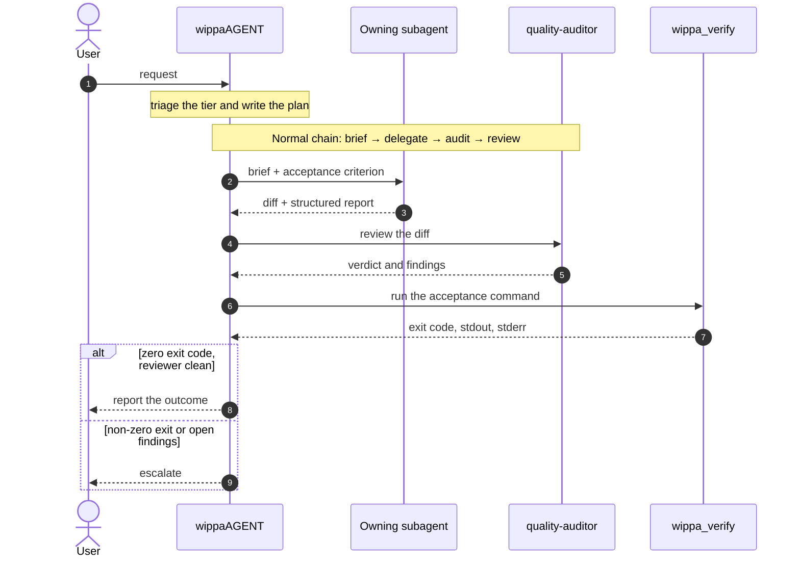

<div align="center">

<!-- wordmark:start - generated from the install.sh banner by npm run wordmark -->
<pre role="img" aria-label="wippaAGENT">
    ██╗    ██╗██╗██████╗ ██████╗  █████╗        
    ██║    ██║██║██╔══██╗██╔══██╗██╔══██╗       
    ██║ █╗ ██║██║██████╔╝██████╔╝███████║       
    ██║███╗██║██║██╔═══╝ ██╔═══╝ ██╔══██║       
    ╚███╔███╔╝██║██║     ██║     ██║  ██║       
     ╚══╝╚══╝ ╚═╝╚═╝     ╚═╝     ╚═╝  ╚═╝       
                                            
 █████╗  ██████╗ ███████╗███╗   ██╗████████╗
██╔══██╗██╔════╝ ██╔════╝████╗  ██║╚══██╔══╝
███████║██║  ███╗█████╗  ██╔██╗ ██║   ██║   
██╔══██║██║   ██║██╔══╝  ██║╚██╗██║   ██║   
██║  ██║╚██████╔╝███████╗██║ ╚████║   ██║   
╚═╝  ╚═╝ ╚═════╝ ╚══════╝╚═╝  ╚═══╝   ╚═╝   
</pre>
<!-- wordmark:end -->

### The only OpenCode setup you'll need.

One orchestrator. Twelve specialists. Three MCP servers.<br/>
Install once, point the config at the orchestrator, and every project gets the same roster, the same routing and the same review discipline.

<br/>

[](LICENSE)
[](https://opencode.ai)
[](https://github.com/RyanAlberts/best-of-Agent-Harnesses)
[](https://github.com/varun1505/awesome-software-factories)


[](https://github.com/wippa-studios/wippaAGENT/actions/workflows/ci.yml)

[**Quick Start**](#quick-start) &nbsp;·&nbsp;
[**Architecture**](#architecture) &nbsp;·&nbsp;
[**The Roster**](#the-twelve-subagents) &nbsp;·&nbsp;
[**Orchestrator**](#how-the-orchestrator-works) &nbsp;·&nbsp;
[**Tools**](#the-tools) &nbsp;·&nbsp;
[**Configuration**](#configuration)

</div>

<br/>

## At a glance

<table>
  <tr>
    <td align="center" width="25%"><h2>1</h2><b>Primary agent</b><br/><sub>Plans, delegates, verifies</sub></td>
    <td align="center" width="25%"><h2>12</h2><b>Subagents</b><br/><sub>Implementation and review</sub></td>
    <td align="center" width="25%"><h2>3</h2><b>MCP servers</b><br/><sub>GitHub, docs, browser</sub></td>
    <td align="center" width="25%"><h2>6</h2><b>Plugin tools</b><br/><sub>Roster lookup, verification and diff reading</sub></td>
  </tr>
</table>

wippaAGENT is a complete OpenCode setup. One primary orchestrator reads the request, plans the work and delegates it. Twelve specialist subagents do the implementation and the review. Three MCP servers give those agents access to GitHub, library documentation and browser automation. A bundled plugin adds roster lookup, an acceptance verifier and diff reading.

### Why teams use it

| | |
|---|---|
| **Predictable routing** | Every request is triaged into a tier, and the tier decides the chain. The choice is written into the plan, so routing is auditable. |
| **Orchestrator can't cut corners** | `wippaAGENT` has edit and shell denied by design. It plans, delegates and verifies; the one command it can trigger is the acceptance command, through the bounded `wippa_verify` tool. |
| **Verdicts from exit codes** | Nothing is reported as done until the acceptance command has returned a zero exit code, and on Normal or High-risk work a reviewer has also seen the diff. |
| **Plan survives the session** | The plan ledger lives on disk at `.opencode/PLAN.md`, and the next session reads it first. |
| **Structured reports** | Every subagent returns the same fixed schema, so the orchestrator reviews fields rather than prose. |

<br/>

## Quick Start

**1. Install**

```bash
git clone --depth 1 https://github.com/wippa-studios/wippaAGENT.git \
  && cd wippaAGENT \
  && ./install.sh
```

That is a clone, not a download piped into a shell: you get the whole working tree, and `install.sh` is a plain shell script you can read before it runs. The tip below previews the install without writing anything.

**2. Point OpenCode at the orchestrator**

```bash
./install.sh --apply-config
```

Or add it by hand to your `opencode.json`:

```json
{
  "default_agent": "wippaAGENT"
}
```

**3. Restart OpenCode**

That's it. Every project you open now has the full roster.

> [!TIP]
> Not sure what the installer will do? Run `./install.sh --dry-run` first. It prints every planned action and writes nothing.

<br/>

## Architecture


*Solid: delegation. Dashed: tool access — labelled where a category holds more than one agent.*

### Prompt budget

The prompt corpus — the primary agent plus the twelve subagents — is budgeted at **35,000 estimated tokens** (one token taken as four characters) and enforced by `npm run check:tokens` in CI. The largest single **subagent** definition carries its own **3,000 estimated token** ceiling, because that prompt is paid on every turn of every dispatch, while the primary agent is covered by the corpus total. Skills split the cost in two: their bodies load only when a skill is called, but OpenCode advertises each skill's id, name and description at every model step, so that always-on listing carries its own **1,250 estimated token** ceiling. `node scripts/token-count.mjs` prints both totals, counting each skill as the listing template emits it, markup included. Around the list OpenCode emits a fixed prologue and an `<available_skills>` wrapper — about **110 estimated tokens**, reported separately by the script; the full always-on skill surface today is about **1,181 estimated tokens**.

CI runs the same chain — `npm ci`, the type check, the test suite, `check:claims`, `check:tokens`, the installer dry run and the eval validation — plus a smoke job that loads the installed tree on a pinned OpenCode binary without credentials. A live dispatch of the eval scenarios through a model is the manual, secret-guarded `dispatch-eval` workflow; the scenario format and live mode are documented in `evals/README.md`.

<br/>

## Install

The installer writes into one of two scopes.

<table>
<tr>
<td width="50%" valign="top">

**Global**<br/>
Every project on this machine.<br/>
Files land in `~/.config/opencode/`, or in `$OPENCODE_CONFIG_DIR` when that variable is set.

```bash
./install.sh --global
```

</td>
<td width="50%" valign="top">

**Project-local**<br/>
A single project.<br/>
Files land in `<project>/.opencode/`.

```bash
./install.sh --project /path/to/your/project
```

</td>
</tr>
</table>

With no directory argument, `--project` uses the current directory:

```bash
./install.sh --project
```

> [!NOTE]
> The project directory must already exist. The installer creates `.opencode/` inside it, but it does not create the project itself.

### Installer flags

Every flag is non-interactive, so the installer runs unattended in a script or a CI job.

| Flag | Effect |
|------|--------|
| `--global` | Install into `~/.config/opencode/`, or into `$OPENCODE_CONFIG_DIR` when that variable is set. This is the default. |
| `--project [DIR]` | Install into `<DIR>/.opencode/`. `DIR` defaults to the current directory. |
| `--dry-run` | Print every planned action and write nothing. |
| `--force` | Overwrite files that already exist. |
| `--uninstall` | Remove the agent files, the skills and the plugin when they still match the installed copy. Files you changed and the config file are left alone. |
| `--apply-config` | Add the required keys the target `opencode.json` is missing and leave the ones you already set alone, except an `agents.build` entry in the demoted shape this installer used to write, which is migrated to `disabled: true` with your other keys kept. JSONC comments and trailing commas are accepted, and the config is validated before anything is copied. |
| `-h`, `--help` | Print the usage text. |

### Requirements

- `bash` and the usual POSIX utilities (`cat`, `cmp`, `cp`, `id`, `ls`, `mkdir`, `printf`, `rm`, `rmdir`)
- `tput` is optional: the installer uses it only to read the terminal width, and falls back to 80 columns when it is unavailable
- Node, **only** when you pass `--apply-config`
- The installer runs from any working directory, and refuses to run if the agent definitions are missing from the checkout it was started from

### What gets installed

| What | From | To |
|------|------|-----|
| Primary agent and twelve subagents | `wippaAGENT.md` and `categories/*/*.md` | `<scope>/agents/` |
| Skills (all of `skills/`, currently seven) | `skills/*/` | `<scope>/skills/*/` |
| Tools plugin | `tools/` | `<scope>/plugins/wippa-subagent/` |

`<scope>` is `~/.config/opencode/` for a global install and `<project>/.opencode/` for a project-local install. That is **13 agent files** in total: one primary agent plus twelve subagents.

Agent files are copied flat. The category directory is not preserved in the destination, so the agent id is the file name: `categories/01-core-development/core-developer.md` becomes `agents/core-developer.md`. Ids stay flat and predictable. Names in the old single-specialist style, such as `python-pro`, become category-level names here, such as `core-developer`.

> [!IMPORTANT]
> Outside the paths it installs to, the installer never touches files it did not create, and without `--force` it skips anything that already exists rather than overwriting it.

<details>
<summary><b>Running OpenCode against this repository</b></summary>

<br/>

The `opencode.json` in this repository configures the checkout itself; it is not the key set the installer writes. `wippaAGENT.md` sits at the repository root, where OpenCode's agent discovery does not look, so a bare `opencode` run in a fresh clone finds no `wippaAGENT` and falls back to the default agent.

To use the repository as a live OpenCode project, install it into the checkout:

```bash
./install.sh --project .
```

That creates `.opencode/` holding the agents, the skills and the tools plugin. With `--apply-config`, it also merges the required configuration keys into `.opencode/opencode.json`. `.opencode/` is gitignored, so a local install never pollutes the repository. One caveat: a project install flattens the agent files into `.opencode/agents/`, and the plugin's roster lookups prefer that installed copy over the live `categories/` tree, so while the install is present, edits to `categories/*.md` do not show up in `wippa_subagent_*` results until you re-run the install with `--force` or remove the installed copy.

</details>

<br/>

## The twelve subagents

| Agent id | Category | Remit |
|----------|----------|-------|
| `core-developer` | Core Development | Application code end to end: API contract, authentication, services, frontends, GraphQL, mobile, desktop and real-time transport. |
| `language-specialist` | Language Specialists | Language-specific implementation, idiom, tooling and ecosystem conventions across the framework landscape. |
| `infrastructure-engineer` | Infrastructure | Cloud architecture, Terraform, containers, Kubernetes, networking, CI/CD, observability, Windows infrastructure and PowerShell. |
| `quality-auditor` | Quality & Security | The lean general reviewer: correctness, architecture, test strategy, accessibility, interface testing and performance review. |
| `security-reviewer` | Quality & Security | Security audit, penetration testing, Active Directory posture, compliance and privacy, dependency and supply-chain audit. |
| `debugger` | Quality & Security | Bug reproduction and root-cause isolation, error and log analysis, test automation, flake control, resilience and chaos experiments. |
| `data-engineer` | Data & AI | Data platforms, pipelines, databases and query tuning, machine learning and model serving, NLP and reinforcement learning. |
| `developer-experience` | Developer Experience | Build tooling, CLIs, dependency management, documentation and developer ergonomics. |
| `domain-specialist` | Specialized Domains | Regulated and platform-shaped verticals: finance, payments, health, legal, embedded, IoT, blockchain, Microsoft 365, SEO and WordPress. |
| `product-strategist` | Business & Product | Requirements, roadmap, backlog, experiments, content and landing pages, licensing and product decisions. |
| `orchestration-lead` | Meta & Orchestration | Planning support, multi-domain coordination, agent installation, error recovery and the GitHub issue, pull request, CI and release workflow. |
| `research-analyst` | Research & Analysis | Investigation, comparison, evidence gathering and written analysis, plus cheap recon passes that return a structured summary of files seen, relevant paths and key findings. |

<br/>

## The primary agent

**`wippaAGENT`** is the orchestrator. It never edits a file and holds no shell of its own; the one command it can trigger is the acceptance command, through the bounded `wippa_verify` tool. Both permissions are denied to it by design, so it cannot bypass the roster.

What it does instead:

1. **Reads** the request and the repository
2. **Plans** the work and writes the plan
3. **Dispatches** each piece to the subagent that owns it
4. **Reviews** what comes back
5. **Checks** the result against the acceptance criterion
6. **Reports** the outcome

It holds one line: nothing is reported as done until the acceptance command has returned a zero exit code, and no Normal or High-risk work is reported done before a reviewer has seen the diff. The criterion is run through `wippa_verify`, so the verdict comes from the tool's exit code rather than from any agent's prose.

<br/>

## How the orchestrator works

Four behaviours separate this setup from a plain roster of agents.

### 1. Triage tiers

Every request is classified before a plan is written, and the tier decides the chain.

| Tier | Applies to | Chain |
|------|-----------|-------|
| **Trivial** | Single-file, low-risk work with no behavioural, auth, input, secret, dependency, CI or config impact | Straight to the owning implementer. No audit pass. |
| **Normal** | Everything in between | Brief → delegate → audit → review |
| **High-risk** | Auth, input handling, secrets, dependencies, or anything touching CI or config in a breaking way | Cheap recon pass before anything is written, then a review that cannot be waived |

Tiers escalate, never de-escalate, and the tier chosen is stated in the plan so the routing is auditable.

**One request, end to end**



### 2. Two-iteration reviewer cap


The review loop runs at most **two iterations** per piece of work. After the second iteration, if the reviewer still reports open findings, the orchestrator stops looping and escalates to you with three things: what is still broken, what a fix would cost, and whether to accept, defer or fund another round. An open finding at report time is disclosed as an open finding, never hidden behind one more attempt.

### 3. Plan ledger

The plan lives on disk at `.opencode/PLAN.md` in the working directory. It holds:

- The agreed plan
- The decisions made, including tier calls and tie-break routings
- The work items in flight
- The work items completed
- The open risks

Every item names its owner subagent and its acceptance criterion. The orchestrator denies edit, so it delegates the file write with the exact content verbatim. The next session reads the ledger first, and where the ledger and the repository disagree, **the repository is the truth**. High-risk or structural changes are presented for approval before any code is written.

### 4. Subagent return contract

Every subagent returns the same fixed schema in its final message:

| Field | Contents |
|-------|----------|
| **Files changed** | What was touched |
| **Commands run** | Each command with its real exit code |
| **Open risks** | Anything unresolved |
| **Confidence** | A level, plus a statement of what would falsify it |
| **Acceptance status** | Optional |

The orchestrator reviews those fields rather than the prose around them. A missing field is an incomplete report that goes back to the subagent, never one the orchestrator fills in itself.

<br/>

## Trust model

Permissions are enforced by OpenCode rules, not by prompts. The orchestrator's edit and shell deny is enforced. The one deliberate exception is `wippa_verify`, which runs the command you give it, and it is behind its own permission action: the tool asserts `verify` with the command as the resource before it spawns anything, so the same rule list that governs `shell` governs it.

On top of that assertion sits a guard that runs before the permission check and before any spawn. The guard is an allowlist of the acceptance surface with a character policy on top — not a sandbox. Its single source is `tools/guards.ts`; every sentence below is derived from it:

- **Character policy.** Command substitution, expansion, redirection, pipes, statement separators, newlines and carriage returns are refused anywhere in the command string; only `&&` chains are accepted, and any `&` that is not exactly `&&` (so `&&&` too) is refused; a segment beginning `NAME=` is refused as an environment-variable assignment prefix; a command word may not be a path — only the exact string `./install.sh` may be run by path, so a planted `./file` cannot be executed.
- **Allowlist.** Every segment's command word must be named in `tools/guards.ts`, or be exactly `./install.sh`, or the segment never runs: `npm` with only `test`, `run` and `ls`, the subcommand immediately after `npm` and any option in that position failing closed, so `npm pkg set`, `npm config set` and `npm --yes exec` are refused; `git` with only `status`, `log`, `diff`, `show`, `blame`, `ls-remote`, `rev-parse`, `describe`, `grep`, `shortlog`, `fetch`, plus `branch` and `remote` in pure-listing form; the read-only utilities `grep`, `rg`, `cat`, `head`, `tail`, `wc`, `ls`, `test`, `echo`, `true`, `false`, `basename`, `dirname`, `realpath`, `pwd`, `sort`, `uniq`, `tr`, `cut`, `stat`, `sha256sum`, `which`, `date` — `sort` and `uniq` only under their read-only flag allowlist, `rg` without `--pre` and `--pre-glob` — and the inert `sleep`, `seq` and `exit`; the static checks `bash -n <file>` (`-n` must be the first argument, every later word a file name) and `shellcheck`; and `./install.sh` only with `--dry-run`. Everything else — `node`, `npx`, `python3`, `sh`, `sed`, `curl`, `gh`, `docker`, `awk`, `xargs`, `find`, `make`, `env` — is denied because it is not on the list.
- **Fast-fail denials, each with a reason.** The `sudo` and `rm` families, network and archive tools, file mutators, `awk` and `xargs` are refused as words, flat and inside quotes; interpreter-plus-eval-flag pairs such as `bash -c`, `python -c`, `node -e` and `sed -i` are refused; in a segment whose command word is `git`, git's global options (`-c`, `-C`, `--git-dir`, `--work-tree`, `--exec-path`, `--paginate`, `--no-pager`) are refused in both `--flag` and `--flag=value` form, any option before the git subcommand fails closed, the exec-channel options `--upload-pack`, `--open-files-in-pager`, `--ext-diff` and `--textconv` are refused anywhere in the segment, and any argument containing `::` (transport syntax such as `ext::cmd`) is refused; `git fetch` refuses a `+` refspec; `git show`, `git diff`, `git log` and `git archive` refuse `--output`; `sort` and `uniq` refuse every option outside their read-only flag allowlist, so `sort -o` writes nothing and `sort --compress-program=…` runs nothing; `rg` refuses `--pre` and `--pre-glob`; and `install.sh` runs only with `--dry-run`, only as the command itself — `cat install.sh` reads it as data.
- **Nothing is inferred as read-only.** `git worktree list`, `git submodule status`, `git stash list` and `git bisect log` are denied: the subcommand allowlist is explicit, so only the subcommands named above pass.
- **Documented residual.** `npm test` and `npm run <script>` execute whatever the project's package.json scripts contain; the guard inspects the npm invocation, not the script body. Beyond that, each allowlisted command is policed only where `tools/guards.ts` writes a rule — git's global and exec-channel options, `sort`'s and `uniq`'s flag allowlists, `rg`'s denied `--pre` flags, `bash`'s positional rule — so an option no rule names is passed through to the command itself.

The guard is not a sandbox: an allowed command runs with the authority of the user running OpenCode, and package.json scripts are trusted input. The shipped frontmatter repeats the shell guards as `verify` rules, so a host with no rules configured is still not left without a guard. A caller's `cwd` must not contain `..` segments, line breaks or null bytes, or it is refused with a stated reason. The call runs asynchronously, stops when the call is cancelled, and is bounded by a 5-minute default timeout and capped output. Treat an acceptance command as you would any shell command.

`wippa_diff` validates its `base` before it reaches git: absolute paths, `..` traversal, option-like prefixes, and shell-significant characters are refused with a stated error rather than passed through, so the diff tool cannot be used to aim git at an arbitrary path.

**Per-agent enforcement**

| Agent | edit | shell | verify | everything else |
|-------|------|-------|--------|-----------------|
| `wippaAGENT` | denied | denied | `rm -rf *`, `sudo *`, `git push --force *` denied | `subagent *` allowed |
| `core-developer`, `language-specialist`, `infrastructure-engineer`, `data-engineer`, `developer-experience`, `domain-specialist` | allowed | allowed | `rm -rf *` and `sudo *` denied | `rm -rf *` and `sudo *` denied |
| `quality-auditor` | denied | allowed | `rm -rf *` and `sudo *` denied | `rm -rf *` and `sudo *` denied |
| `debugger` | allowed | allowed | `rm -rf *` and `sudo *` denied | `rm -rf *` and `sudo *` denied |
| `security-reviewer` | denied | allowed | `rm -rf *`, `sudo *` and `git push --force *` denied | `rm -rf *`, `sudo *` and `git push --force *` denied |
| `orchestration-lead` | allowed | allowed | `rm -rf *`, `git push --force *` and `npm install *` ask; `sudo *` denied | `rm -rf *`, `git push --force *` and `npm install *` ask; `sudo *` denied |
| `research-analyst`, `product-strategist` | allowed | deny all shell | deny all verify | no additional deny rules — read, web and MCP tools remain reachable |

No rule restricts MCP reach per agent: every agent can reach the `github`, `context7` and `playwright` servers. Two boundaries stand in instead. The `github` server is registered with the `repos`, `issues`, `pull_requests` and `actions` toolsets only — the repositories, issues and pull requests, review comments, CI status and releases the roster routes through `orchestration-lead` — so toolsets this workflow never uses are not even registered. And the scope of `GITHUB_PERSONAL_ACCESS_TOKEN` is the real limit on what the `github` server can reach: a fine-grained token scoped to one repository, carrying only the Issues, Pull requests, Contents and Actions permissions.

Subagents cannot start further subagents (`experimental.subagent_depth` is 1).

Routing — which agent owns what — and the "report only to me" line in every brief are prompt-level conventions, not permissions. The enforcement story is the table above plus the narrowed `github` toolsets and the scope of `GITHUB_PERSONAL_ACCESS_TOKEN`: a fine-grained token is the real limit on what the `github` server can reach.

<br/>

## The three MCP servers

| Server | What it gives the agents |
|--------|---------------------------|
| **`github`** | Repositories, pull requests, issues, actions and code security through the GitHub API. |
| **`context7`** | Version-matched documentation for libraries and frameworks, so guidance matches the version in the lockfile. |
| **`playwright`** | Browser automation: navigate, interact and read the rendered page. |

The GitHub server expects `GITHUB_PERSONAL_ACCESS_TOKEN` in the environment. The Playwright server runs locally through `npx`.

<br/>

## The tools

The bundled plugin adds six tools: four for finding and reading the roster, one for checking work, and one for reading a diff.

The catalog is the roster: the twelve agents this bundle ships, plus any id listed in `WIPPA_CUSTOM_AGENT_IDS`. From the global agent directory, where every project's agents live together, only those ids are indexed, so an unrelated agent installed for another project does not appear in a search or inflate a list. A project directory, a `WIPPA_AGENT_DIR` override, and the bundle's own tree are indexed in full.

| Tool | Question it answers |
|------|---------------------|
| `wippa_subagent_search` | Which agents match this task, by name, by category or by a word from their description? |
| `wippa_subagent_get` | What exactly does one agent do? Full definition, prompt and permissions. |
| `wippa_subagent_list` | What is available at all, organised by category? |
| `wippa_subagent_invalid` | Is the cached catalog stale? Clears the cache so the next read is fresh. |
| `wippa_verify` | Did the acceptance command pass? Runs it in a shell asynchronously, with a timeout, capped output and cancellation, and returns the real exit code with stdout, stderr and how long it ran, so a pass/fail verdict never rests on prose. A command whose command word is outside the guard's allowlist — or one with substitution, redirection, pipes, separators, an assignment prefix or an eval-flag pair — never runs: the guard refuses it before the permission check and before any spawn, with the reason in the result. |
| `wippa_diff` | What changed? Returns the working, branch or committed diff as structured per-file entries with the patch, additions and deletions and status, so the orchestrator can read the diff itself without a shell. The `base` ref is validated first: absolute paths, `..` traversal and option-like input are refused with a stated error. |

The `wippa-subagent-search` skill documents the four roster tools, explains which one to reach for, and gives the equivalent procedure using `read`, `glob` and `grep` when the plugin is not connected.

<br/>

## Configuration

The agent set is inert until `default_agent` points at the orchestrator. Add it to the config file for the scope you installed into.

| Scope | Config file |
|-------|-------------|
| Global | `~/.config/opencode/opencode.json`, or `$OPENCODE_CONFIG_DIR/opencode.json` when that variable is set |
| Project-local | `<project>/.opencode/opencode.json` |

```json
{
  "default_agent": "wippaAGENT"
}
```

The installer prints the full set of keys it expects before the summary, whether or not `--apply-config` is passed: `default_agent`, `agents.general`, `agents.explore`, `agents.build` and `mcp.servers`. Run it with `--apply-config` to merge those keys into the target config automatically. Every key you already set is left alone and reported as kept, with one exception: an `agents.build` entry that still carries the demotion this installer used to write — `mode: "subagent"` plus a deny entry for `subagent` on `*` — is migrated in place, so `mode` and `permissions` are removed, `disabled: true` is set, and every other key you added is kept. An entry of any other shape, including a hand-edited one that also demotes the built-in, is preserved untouched. The target may be JSON or JSONC — comments and trailing commas are accepted — and it is validated before the first file is copied, so a config that cannot be parsed leaves nothing half-installed. When a key has to be added the file is rewritten as plain JSON, so comments are not preserved in that case; when every key is already present the file is left byte-identical.

<details>
<summary><b>What each key does</b></summary>

<br/>

| Key | Purpose |
|-----|---------|
| `default_agent` | Makes `wippaAGENT` the entry point for every session. |
| `agents.general` | Set to `disabled: true`. It is an OpenCode built-in, and this set supplies its own agents in its place. |
| `agents.explore` | Set to `disabled: true`, for the same reason. |
| `agents.build` | Set to `disabled: true`. It is an OpenCode built-in coding agent, and this set supplies its own implementers in its place, so no second implementer appears in the roster. |
| `mcp.servers` | Registers the `github`, `context7` and `playwright` servers. |
| `permissions`, `compaction`, `experimental.subagent_depth` | Checkout-only keys. They are set in the repository's own `opencode.json`: `permissions` allows `subagent` on `*`, `compaction` summarises long sessions, and `subagent_depth` is `1`, so a subagent cannot start another subagent. `--apply-config` does not merge them, so an installed scope uses OpenCode's documented defaults, which match. |

The skills and the tools plugin need no configuration entry. They are installed into `<scope>/skills/` and `<scope>/plugins/`, and both of those directories are auto-discovery locations in OpenCode V2, so the two are picked up automatically.

</details>

### Environment variables

`env.example` documents the variables the setup expects. Export them in the shell before starting OpenCode.

| Variable | Used by |
|----------|---------|
| `GITHUB_PERSONAL_ACCESS_TOKEN` | The `github` MCP server |
| `WIPPA_AGENT_REGISTRY` | See `env.example` |
| `WIPPA_AGENT_DIR` | See `env.example` |
| `WIPPA_CUSTOM_AGENT_IDS` | Comma-separated agent ids expected to live in the user's own global configuration. They are indexed alongside the roster and are exempt from roster drift reporting. Used by the tools plugin. |
| `WIPPA_BANNER` | The installer only. `on` forces the wordmark, `off` suppresses it; unset, it prints only on a UTF-8 terminal wide enough for the art. It has no effect on OpenCode. |

> [!WARNING]
> `opencode debug config` lists every configuration source the session loads. On the CLI versions checked here (v2.2.0 and v2.2.2) MCP server headers are redacted as `***`, but the rest of the resolved configuration prints in full. Treat the output as sensitive, and do not paste it into an issue or a chat.

Restart OpenCode after changing the config so the new roster is picked up.

<br/>

## License

Released under the **MIT License**. See [`LICENSE`](LICENSE) for details.

<br/>

<div align="center">

**wippaAGENT** &nbsp;·&nbsp; built by [wippa-studios](https://github.com/wippa-studios)

<sub>One setup. Every project. Same discipline.</sub>

</div>
